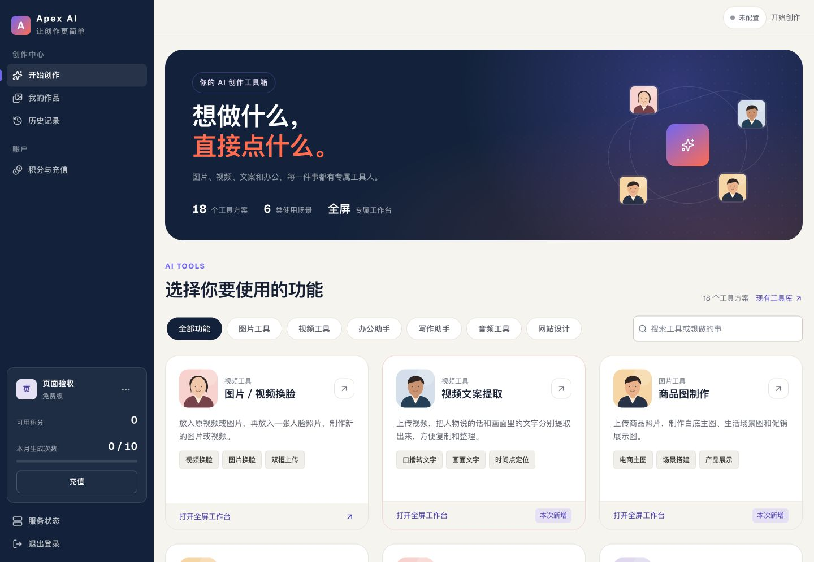
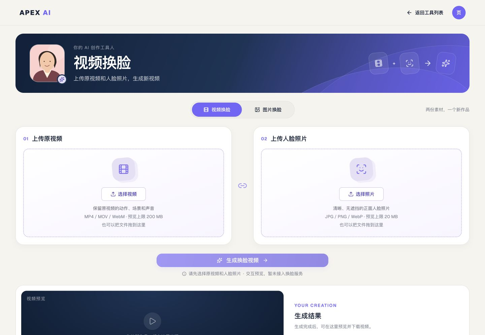
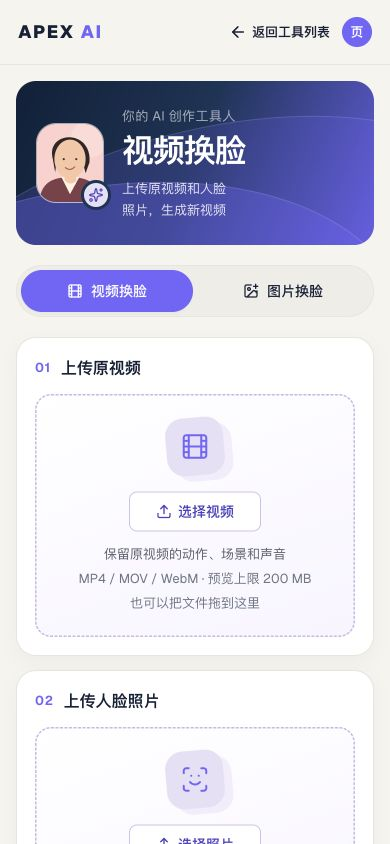

# Apex AI 页面接入与部署交接

本次把已确认的 18 个工具首页与全屏工作台接入正式 Next.js 页面。
预览与正式网站共用 `components/tools/`，头像位于 `public/avatars/`，
不再需要从预览目录复制页面。工具提交会创建一条真实 issue 并交给**该工具指定的
专家**执行；专家的结果预期以评论或附件的形式出现在 issue detail，端到端
行为以验收项 9 为准，交付时尚未在线上验证。

## 部署对象

- 仓库：`apexai-sg/multica`，应用：`apps/aurora`。
- 构建命令：在仓库根目录执行 `corepack pnpm install --frozen-lockfile`，再执行 `corepack pnpm --filter @multica/aurora build`。
- 容器沿用 `Dockerfile.aurora`，其中已复制 Next.js 静态文件与 `apps/aurora/public`。请重新构建前端镜像，记录新的提交 SHA、镜像标签和 digest，并沿用部署环境现有配置。只更新后端或重启旧镜像不会更新页面。
- `pnpm --filter @multica/aurora preview` 仅用于本地设计验收，不能代替正式构建；不要把其虚构账号、积分或模拟 API 部署到生产。
- **必须先跑数据库迁移**：本版新增 `server/migrations/5000_aurora_carrier_invocation`（把 Aurora 专家 carrier 改为 `public_to`、补 workspace 调用目标、把 carrier 与托管运行时的 owner 对齐到工作区 owner）。只加列不加表；`migrations.AllVersions()` 供 readiness 比对，漏跑会报 `migrations=out_of_date`。不需要新增模型密钥或环境变量，沿用现有登录、工作区和 API 配置。

## 正式访问入口

以下 `{workspaceSlug}` 为当前用户实际工作区标识，不能填写本地预览的 `preview`。

| 页面 | 路径 |
| --- | --- |
| 登录后首页 / 18 个工具 | `/{workspaceSlug}/skills` |
| 图片／视频换脸 | `/{workspaceSlug}/tools/face-swap` |
| 视频文案提取 | `/{workspaceSlug}/tools/video-transcript` |
| 商品图制作 | `/{workspaceSlug}/tools/product-images` |
| 其他工具 | 首页对应卡片链接，统一为 `/{workspaceSlug}/tools/{toolId}` |
| 原有后端工具库 | `/{workspaceSlug}/skills/connected`，首页“现有工具库”入口 |

工具详情页使用完整窗口，不包在侧栏或抽屉内；原有登录和工作区访问校验继续生效。
账号、积分、作品、历史记录、服务状态继续使用现有真实系统。
执行者由服务端决定：`server/internal/aurora/tool_experts.go` 是 18 个工具到
专家的唯一映射，客户端只提交工具 id，从不按名称或 agent 列表猜测。目录已扩到
**33 个专家**（新增 9 个本地撰写的专家，补齐原先没有对应专家的工具）。

工作区**首次进入 Aurora**（打开任一工具页并读取工具目录、加载 `/skills` 技能目录，或直接提交工具任务）时会一次性
seed 全部 33 个专家 carrier 和 1 条托管运行时；此后只做键集比对，不重复写入。
carrier 的权限是 `public_to` 并绑定 workspace 调用目标，owner 恒为**工作区
owner**（不是触发 seed 的人），因此任何成员都能提交；运行时同样归工作区 owner。

安全边界：carrier 是携带 provider 凭据的 shell agent，且这些凭据在工作区内**共享**
——凡能提交工具任务的成员都等于能指挥该 agent。部署时请把这一点视为工作区成员
授权的一部分；不要把 Aurora 开放给不可信成员。

工具任务走普通 issue/agent 通道，**不计 Aurora 积分**。映射的专家不在可指派列表
（`no-agent`）、未绑定运行时（`no-runtime`）或服务端无映射（`no-expert`）时，
提交按钮保持禁用并在页面上说明原因。
原有后端工具库保留其现有提交路径，避免前端改版中断已有能力。

## 部署测试版后的验收

1. 使用真实账号登录，进入自己的 `/skills`：共 18 个工具，前三个依次为换脸、视频文案提取、商品图制作。
2. 逐个打开工具，应跳转独立 `/tools/{toolId}`，没有右侧抽屉或常驻侧栏；直接刷新详情页也能打开。
3. 分类、搜索后进入工具，点击“返回工具列表”，分类和搜索词应保留；浏览器后退、前进应正常。
4. 电脑与手机检查所有头像、页面宽度和滚动，底部结果区应可以到达。头像应从前端域名 `/avatars/experts/*.png` 加载。
5. 换脸支持切换图片／视频，两份素材独立选择、替换与移除；未选择必填素材时主按钮不可点击。
6. 视频文案提取的人物说话与画面文字分开显示。示例结果必须保留“与上传的视频无关”的标注，不能当成提取成功。
7. 用退出登录的浏览器打开工具链接，仍应进入登录流程；错误的工具标识应显示未找到页面。
8. 检查“现有工具库”、作品、历史记录和账号入口。先由 Hannah 确认外观，再发布到正式域名。
9. 提交一个文本类工具任务（如“文案创作”）：应自动打开 issue detail，agent 预期在评论/附件中返回结果。若该 issue 上始终没有任务或评论，记为本项验收失败。
10. 在未配置媒体 provider 的环境下提交一个媒体类工具任务：agent 应说明限制并给出方案，不能出现伪造图片/视频。若环境已配置 provider，真实产出同样视为通过。

## 任务执行与结果

每个工具页面提交时：

1. 把已选择的本地文件上传为 issue 附件（沿用现有附件上传限制）。
2. 调用 `POST /api/aurora/tools/{toolId}/runs`。服务端解析该工具指定的专家、seed
   carrier、校验附件属于本工作区、确认运行时可用，然后创建 issue：标题取工具名与
   需求摘要，描述包含工具、需求、设置、素材和执行专家，并分配给该专家 carrier。
   未映射返回 409 `tool_executor_unmapped`，运行时不可达返回 503，两种情况都**不建 issue**。
3. 创建成功后自动打开 `/{workspaceSlug}/issues/{identifier}`（issue detail）；配置了 `NEXT_PUBLIC_WEB_ORIGIN` 时跳到该 origin 的同名路径，未配置时由 Aurora 自己渲染。

预期由 agent 在该 issue 上执行任务，并把结果以评论或附件返回。前端不再展示“尚未接入”的模拟结果，
但结果区仍保留布局占位与内置示例（示例明确标注与上传文件无关）。
上传与 issue 创建沿用现有能力；任务进度、取消、失败重试和计费取决于 Multica 的部署配置，需在验收中确认。

限制：文本/方案类任务可由普通 agent 完成；图片、视频、音频的**真实媒体生成**仍取决于
后端是否配置了对应 provider。issue 描述会要求 agent 在无法生成真实媒体时说明限制并给出方案，
这是对 agent 的指令而非平台保证，验收时以实际结果为准。
映射的专家 carrier 不在可指派列表、已归档或失去运行环境时提交按钮禁用，
因此不会出现“提交成功但迟迟不执行”的情况——前提是提交前预检与提交时的服务端检查
一致；运行环境在提交瞬间掉线时，服务端返回 503 且不创建 issue。映射或列表加载失败、
carrier 缺失或失去运行环境时，页面都提供“重新加载”。

## 本次验证记录

- `pnpm --filter @multica/aurora typecheck` 通过。
- `pnpm --filter @multica/aurora lint` 通过。
- `pnpm --filter @multica/aurora exec vitest run`：148 项通过，其中 `components/tools/use-tool-submission.test.tsx` 覆盖提交 hook（上传、调用 run 端点、导航、失败路径、`no-expert`/`no-agent`/`no-runtime` 状态与 18 个工具 id 契约）。
- `pnpm --filter @multica/aurora build` 通过，路由包含 `/[workspaceSlug]/tools/[toolId]`、`/[workspaceSlug]/skills/connected` 与 `/[workspaceSlug]/issues/[id]`。
- `node --test scripts/aurora-import-experts.test.mjs` 9/9 通过。
- 未在开发机执行真实模型调用或线上登录提交；部署后由真实账号验收任务提交与 issue detail 结果。

