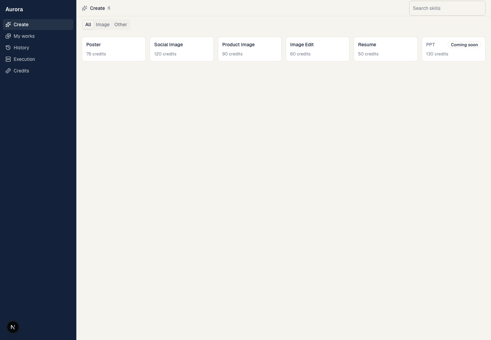
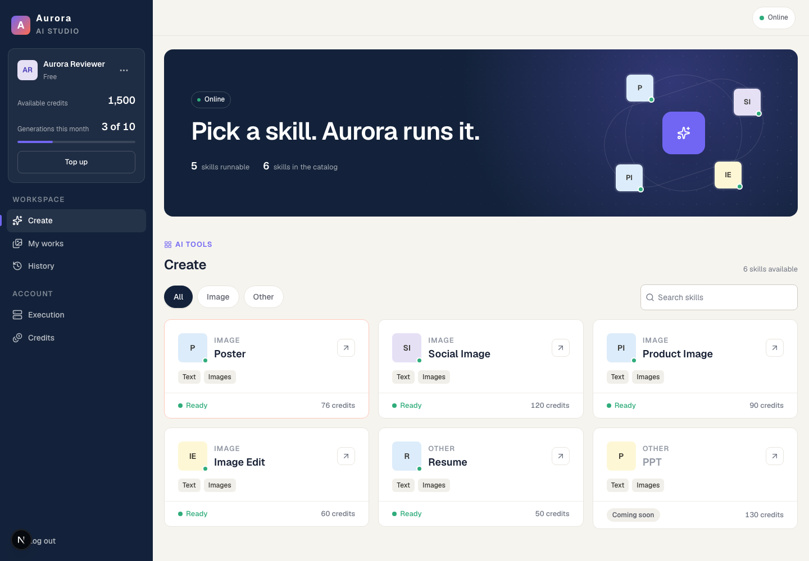
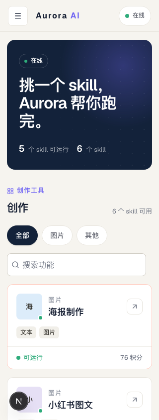

# Aurora UI acceptance evidence

Product commit: `218630d3513db639f1ce530330d042e364bbd14e`. Verified on 2026-10-11 (Asia/Singapore). This evidence-only addition does not change product code.

Source: [plan PR #228](https://github.com/eanfs/multica/pull/228), [Story #229](https://github.com/eanfs/multica/issues/229), and ordered tasks #230–#240. All eleven tasks were implemented sequentially in an isolated worktree and independently reviewed.

## Final verification

| Gate | Result |
|---|---|
| `pnpm typecheck` | 12/12 tasks passed |
| `pnpm lint` | 9/9 tasks passed; existing warnings remain |
| `pnpm test` | 8/8 suites passed; includes 6,335 views and 89 Aurora tests |
| `pnpm check:ui-radii` | Passed |
| `pnpm check:ui-exports` | Passed |
| `pnpm --filter @multica/aurora build` | Passed; existing shared CSS highlight diagnostic remains |
| Responsive browser matrix | 210/210 cases passed |
| Focus and flow browser checks | All final helpers passed |

Turbo may reuse valid results for unchanged packages. Commands above were rerun after the final product correction. Generated Next.js type-import changes from the build were restored; they are not product changes.

The responsive matrix covers five locales (English, Simplified Chinese, Japanese, Korean, French), seven widths (320,690,691,900,901,1120,1440), and six routes (directory, works, history, detail, runtimes, billing). It checks document/content overflow, navigation and grid breakpoints, stacked cards, and detail-header geometry. No overflow was observed.

Flow checks cover shell focus containment and nested dialogs, reduced/normal motion, account closure and visible-entry focus across the 900/901 breakpoint in both directions, actual composer backdrops and dismissal, directory filters and zero/one/plural counts, artifact preview/download, history filtering, detail copying, settled-runtime polling, billing pending states and exact synthetic checkout payloads. The runtime navigation link now measures at least40px in both dimensions. Supplementary typography checks covered all five locales at320/390/1440.

## Independent review results

- [Standards review](standards-review.md): four original Minor findings addressed; no new graded findings.
- [Specification review](spec-review.md): runtime target finding addressed; no new graded findings.

These are separate static reviews, not claims that reviewers ran the browser checks. The controller independently ran the final command and browser gates.

### Typography mapping

The final correction uses shared semantic roles. The sole private fluid hero role preserves32–44px; page headings use32px and26px at narrow widths; sections/drawers use24px and22px where previously responsive. Approved normalization includes15→16px body text,17→18px card titles,28→32px stat figures, and56→32px decorative thumbnail initials. Aurora-scoped role overrides cover portals without changing shared UI tokens or other apps.

## Screenshots

All data are synthetic fixtures, not a real account or production catalogue. Development indicators are visible. The earlier screenshot is an **intermediate development checkpoint with part of the theme already applied**, not an unmodified-main baseline.

### Earlier checkpoint

### Final desktop

### Final narrow viewport

## Boundaries and known limitations

- Frontend browser checks intercept synthetic API/WebSocket traffic. They are not backend E2E or proof of agent/provider execution.
- Mobile, backend/DB/TestApiClient E2E, real authentication/OAuth, Stripe/payments, providers/agents, Fleet, Docker and AWS were not exercised. No such operations were authorized.
- Existing act/canvas/i18n/hydration/lint diagnostics and the shared CSS highlight build warning remain disclosed; no warning-free claim is made.
- An early login visual probe allowed requests to an unavailable localhost8080 backend. The final login probe is hermetic (unauthenticated401/config200 fixtures and denied unexpected/external requests).
- Existing first-page history behavior, missing task deep links/timeline and unrelated legacy Chinese terminology are unchanged.
- Neither the source plan PR nor this implementation is automatically merged. The worktree remains available for human review.
